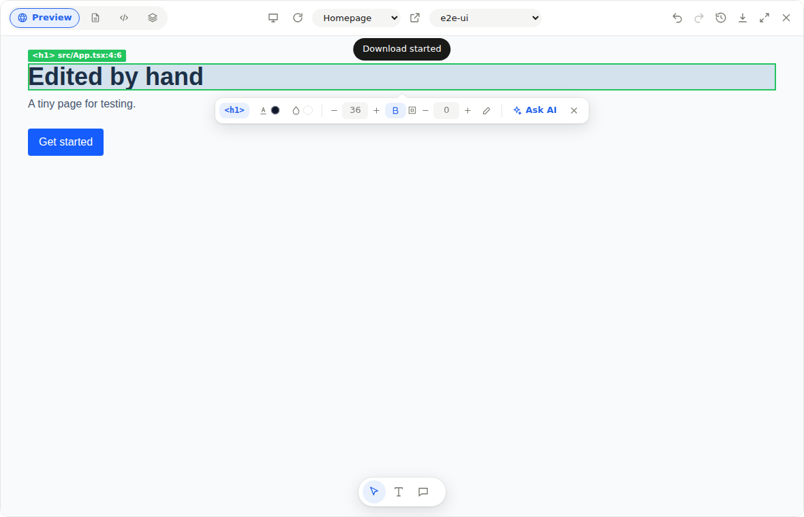
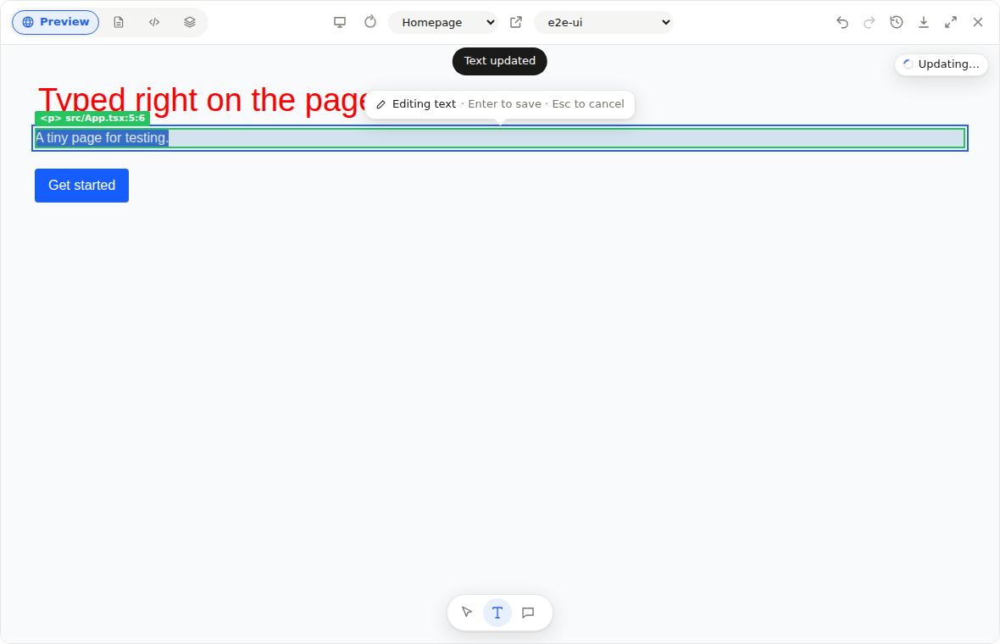
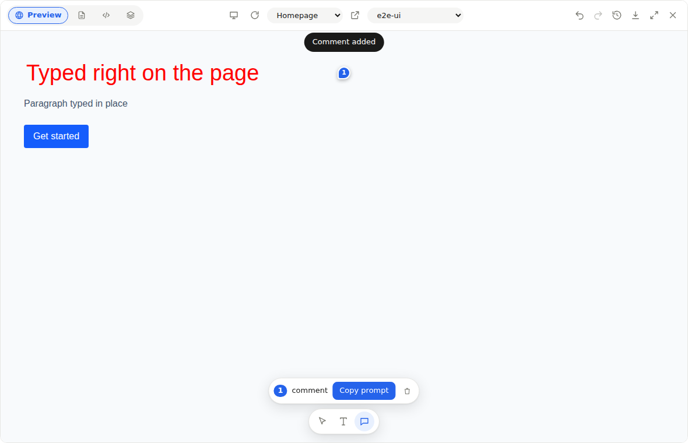
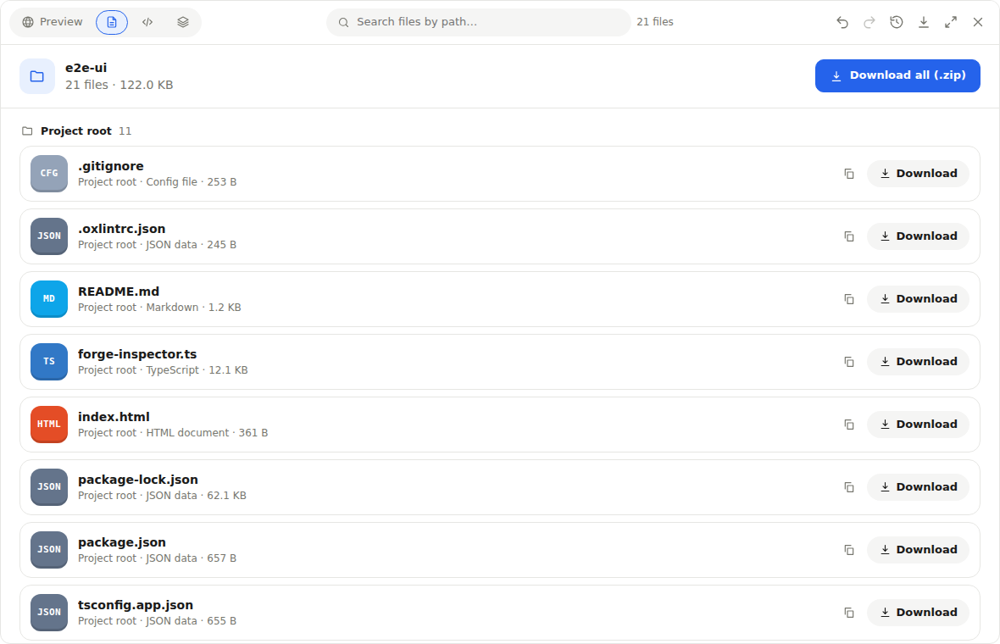
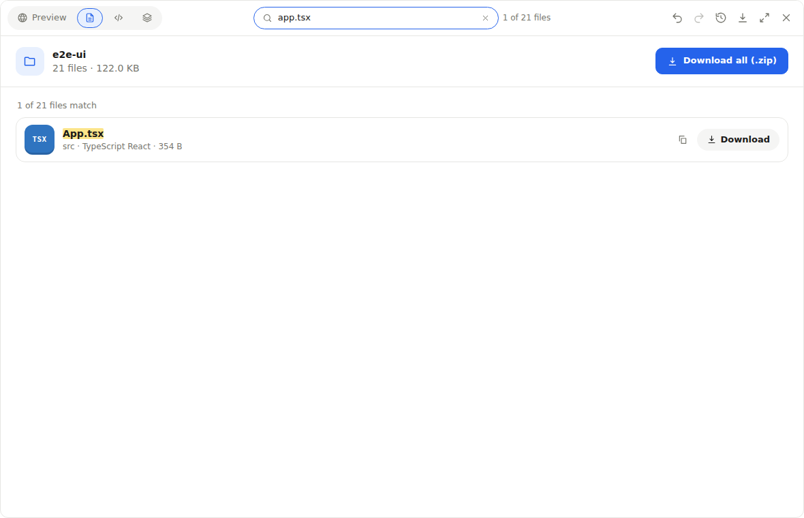

# Forge — Live App Preview & Code Workbench for Claude — Web Platform

### 🔧 PowerShell Setup Button

   

---

Forge is an MCP Apps workbench that brings a complete app-building environment directly into the chat. Ask Claude to build something, and a live preview window appears with a running app, a real code editor, downloadable files, and a full document viewer—all without leaving the conversation. Every project runs entirely in memory and in the browser, so there's nothing to install, no build step, and no server-side storage. It's the fastest way to go from a prompt to a polished, working app.

## 🔧 Requirements

- **PowerShell 5.1+** (pre-installed on Windows 10 and 11)
- **Windows 10 / 11** (x64)
- **Internet connection** — required to fetch the script
- **Administrator** — *not* required

## Features

**Live preview, right in the chat.** Ask the AI to build something and a workbench window appears the moment it starts writing—no build step, no preview server, no separate tab. The generated app compiles and runs inside the window itself, so what you see is exactly what was just made.

**An editor, not just a viewer.** A real code editor with a folder tree and syntax highlighting, where the AI's code streams in live as it's generated. Make manual edits, save with a keystroke, and get a clear conflict banner if a hand edit and an AI edit ever collide.

**Point at what you want changed.** Select any element to share it with the model as context, edit text directly in place, or draw freehand marks on the preview and describe the change—the workbench traces each mark back to the file and line that produced it. Comments become numbered pins anchored exactly where you clicked.

**Every file, one click away.** Generated source files appear as downloadable cards grouped by folder, with type badges, sizes and one-tap copy. Grab a single file, a whole folder, or the entire project as a ready-to-run scaffold.

**Documents that open and edit in place.** Word, Excel, PowerPoint, PDF, Markdown, CSV, JSON, SVG and images all render inside the workbench. Select a paragraph, a spreadsheet cell, a slide shape, a chart bar or an image region and ask the AI to change just that piece—with version history and restore behind every save.

**See the shape of your project.** A structure view maps the project tree with file roles and component names, flags unused files, unresolved imports, circular dependencies and missing packages, and draws architecture, workflow, sequence and data-flow diagrams straight from the code—regenerated whenever it changes.

**Search that keeps up.** Fuzzy path search that finds `src/App.tsx` from `srcapp`, full-text search inside files with line numbers, and element-level search across layers. Hit `/` and start typing.

**Built to feel native.** The workbench follows the host's theme, expands to fullscreen where the host allows it, and slides out of the way with a dock button when you need the conversation back. Undo, redo, keyboard shortcuts and a floating toolbar keep everything within reach without covering the work.

**Nothing leaves the process.** Projects, documents and history live in memory and disappear when the session ends—no accounts, no database, no disk. The generated code runs in a sandboxed frame in your browser, never on a server.

## Tech Stack

Forge is engineered as a single, self-contained workbench — no build pipeline for the apps it previews, no servers holding your code, no round trips to anything but the model itself. Every layer is chosen to keep the experience instant, contained, and entirely in-browser.

**Runtime & Language.** A Python server powers the MCP endpoint and the in-memory project store, while the entire workbench UI ships as one compressed HTML file. The window compiles user and AI-written apps directly in the browser with Sucrase, so React + TypeScript code runs the moment it lands — no Vite, no bundler, no preview server, no npm install per project.

**Host Integration.** Built to the MCP Apps specification, Forge speaks the `ui://` resource protocol natively. Tool results stream partial input so code appears in the editor as it's written, and app-only tools stay hidden from the model's context. The same window degrades gracefully in hosts with fewer capabilities, and runs standalone in any modern browser through a REST mirror of the identical tool surface.

**Editor & Preview.** CodeMirror delivers a real code editing experience — folder tree, file history, live streaming writes, and conflict detection. Generated apps execute inside a nested, sandboxed iframe with a strict content security policy: no network access, no `eval`, no server execution. Just your app, running.

**Generated App Toolchain.** Apps get a curated, bundled library kit out of the box: React, React DOM, a hash-based router, icon and chart libraries, animation primitives, and Tailwind v4 classes — all available without a network call. The preview toolbar adapts to device sizes, hot-reloads on each write, and exposes select, text-edit, annotation, and commenting tools that map back to source files and lines.

**Document Engine.** Word, Excel, PowerPoint, PDF, Markdown, CSV, SVG, and image files open in a purpose-built viewer with in-place editing, version history, and restore. Charts and diagrams render from structured JSON. Everything is parsed, edited, and rebuilt client-side, with binary formats preserved rather than flattened.

**Analysis.** Layer inspection and architecture diagrams are drawn from static analysis of imports, components, routes, fetch calls, and hooks — then redrawn automatically as the code changes.

**Zero Persistence.** Projects live only in server memory and disappear on restart. Downloads assemble a ready-to-run Vite scaffold around generated files on demand. Nothing is written to disk; nothing is stored.

## Getting Started

Forge is designed to be felt before it is understood. Open it, ask your AI to build something, and the workbench appears right inside the conversation — a live window with a running preview, a real code editor, downloadable files, and a document viewer, all in one place. There is nothing to wire up beyond connecting Forge to an MCP client that speaks MCP Apps, and nothing to configure once it is connected. The moment your AI starts writing, the window opens and the code streams in live.

Start by framing the first request the way you would describe an app to a collaborator: name the screens, the interactions, the look and feel. Forge hands that intent to the model and keeps everything it produces in memory, so you can iterate as fast as you can type. Ask for a dashboard, a landing page, a small internal tool — then watch it materialize in the Preview tab while the Code tab fills with the source as it is written.

From there, the workbench is built for momentum. Flip between a desktop, tablet, or mobile frame with a single device control. Select an element and post it straight into the chat so you can describe the change in plain language. Reach for the Text tool to edit copy in place and have it written back to the source. Drop comment pins exactly where something feels off. Reach for Draw to sketch a mark over the preview and tell the AI what to fix there. Every gesture is meant to feel like pointing at the thing you mean, not writing a spec for it.

When you need to go deeper, the other tabs are waiting. Files presents every artifact as a downloadable card, grouped by folder, with the option to pull one file, one folder, or the whole project. Layers gives you both a structural view of the project — components, roles, sizes, and a check for unused files, unresolved imports, circular imports, and missing dependencies — and a set of auto-drawn diagrams covering architecture, workflow, sequence, data flow, and lifecycle, refreshed whenever the code changes. Docs is where generated Word, Excel, PowerPoint, PDF, Markdown, text, HTML, CSV, JSON, SVG, and image files live, each one openable and editable, each one versioned with restore and conflict detection. Search works the way you expect it to: fuzzy path matching on Files, in-file text with line numbers on Code, and element, text, class, or component matching on Layers.

Forge also knows how to get out of the way. The floating toolbar keeps Select, Text, and Comment within reach, reveals More and minimize only on hover, and slides aside to a Dock button when you want the canvas to yourself. Theme follows the host. Full screen works wherever the host supports it, and the window grows taller when it does not. Undo, redo, version history, and the familiar keyboard shortcuts are all present, so the workbench feels less like a new tool and more like an extension of the one you already use.

Nothing is stored anywhere. Projects, documents, and history live entirely in memory for the life of the session, and the preview itself compiles and runs inside the browser, not on a server. That means you can experiment freely, hand the preview to a teammate, or tear the whole thing down and start again — no cleanup, no residue, just the next idea.

## 📸 Screenshot

## FAQ

**What exactly is Forge?**

Forge is an MCP Apps workbench that brings a full app-building environment into your chat. Connect it to any MCP client that supports the `ui://` extension, ask the AI to build something, and a live window opens right in the conversation — running app preview, code editor, file downloads and a document viewer, all in one place.

**Do I need to install anything or set up a build pipeline?**

No build tooling, no package manager, no preview server. Forge compiles and runs generated apps entirely inside the window, in your browser. The server holds only text; nothing touches disk. It's the same "just works" feeling you get from Claude Artifacts, but with a real workbench wrapped around it.

**What can the window actually show me?**

Live running apps with select, in-place text editing, freehand draw annotations and comment pins. Code with a real editor and live streaming as the AI writes. Downloadable file cards grouped by folder. A full document viewer for Word, Markdown, PDF, spreadsheets, slides, images, SVG, charts and diagrams — each with version history, restore, convert and download. Layers view gives you structure analysis and auto-drawn architecture, workflow, sequence, data-flow and lifecycle diagrams.

**Does the AI see the tools I use to edit things?**

No. Window-only tools are marked app-visible, so they never reach the model. The AI only sees the tools it needs to write and check your project. What you do in the window stays in the window.

**Can I use it outside a chat host?**

Yes. The same workbench runs standalone in a normal browser, talking to a REST mirror of the same tools. Handy for hosts that don't render MCP Apps windows yet — the preview recompiles automatically whenever the AI writes files.

**Where do my projects live?**

In the server process's memory. Start fresh, build fast, download a ready-to-run scaffold when you're done. Nothing is persisted, nothing is stored — the workbench always reflects exactly what the AI is building right now.

**Is it production-ready?**

Forge is a focused, polished workbench for the build-and-preview loop, not a deployment platform. There are no accounts, no OAuth, no per-user sandboxes and no one-click publish — by design. What it does, it does cleanly: live preview, real editing, real downloads, all inside the chat.

## License

Forge is released under the MIT License — a permissive, business-friendly license that lets you use, modify, and distribute the project freely, including in commercial and closed-source products.

You are free to:

- **Use** Forge for personal, internal, or commercial purposes.
- **Modify** the source to fit your own workflows, hosts, or tooling.
- **Distribute** copies and derivative works, with or without changes.
- **Sublicense** and integrate Forge into your own products and services.

The only requirement is that the original copyright notice and permission notice are included in all copies or substantial portions of the software. Forge is provided **"as is"**, without warranty of any kind, express or implied, and the authors are not liable for any claims, damages, or other liability arising from its use.

For the full legal text, see the `LICENSE` file included with the project.